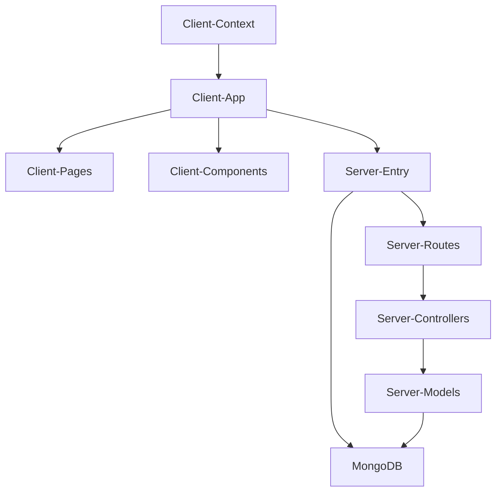

# ShoeVista
ShoeVista 👟 ShoeVista is a full-stack e-commerce web application for browsing and shopping footwear online, built on the MERN stack. It pairs a fast React + Vite frontend with a Node.js/Express REST API and a MongoDB database to deliver a smooth, modern shopping experience.

## Architecture / How it Works

